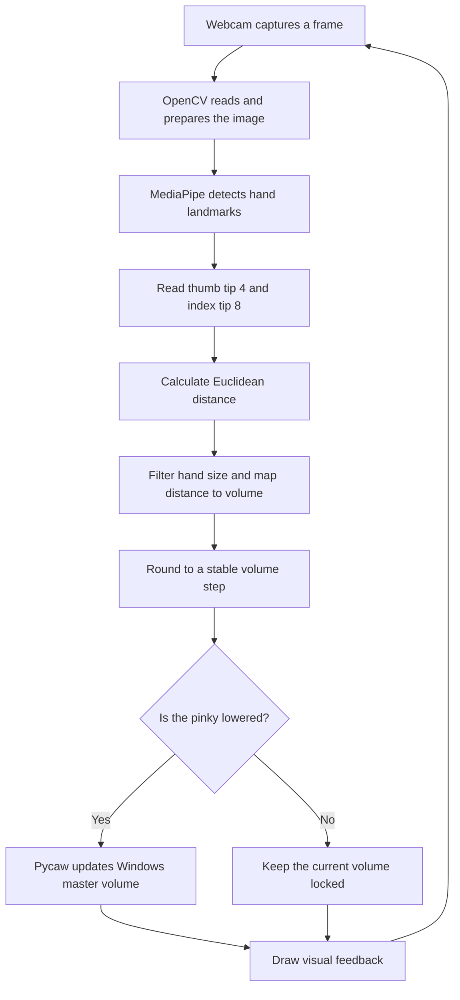

<div align="center">

# ✋ AI Virtual Volume Controller

### Control your Windows system volume with simple hand gestures.

A real-time, touchless volume controller built with **Python**, **OpenCV**, and **MediaPipe**. Move your thumb and index finger apart to raise the volume, bring them closer to lower it, and use a finger gesture to lock adjustments when you want your hand to move freely.

<p>
  
  
  
  
  
</p>

</div>

---

## ✨ Overview

The **AI Virtual Volume Controller** turns a regular webcam into a gesture-based input device for controlling the Windows master volume. Instead of reaching for a keyboard, mouse, or physical volume key, you can adjust audio by changing the distance between your thumb and index fingertip.

The webcam feed is processed frame by frame. MediaPipe identifies hand landmarks, OpenCV handles image capture and visual feedback, and the distance between the relevant fingertips is mapped to a volume percentage. The Windows audio interface is controlled through **Pycaw**.

The project demonstrates a practical Human–Computer Interaction (HCI) application: using computer vision to make a common computer task more natural and contactless. It uses a pre-trained hand-tracking solution rather than training a custom neural network.

## 🚀 Features

- **Real-time hand tracking** using MediaPipe's hand-landmark detection.
- **Gesture-based volume control** using the thumb and index fingertip distance.
- **Live visual feedback** with hand landmarks, a distance indicator, and a volume bar.
- **Smoother adjustments** by mapping finger distance to a bounded volume range and rounding it to steps.
- **Pinky-finger lock** to prevent incidental hand movements from changing the volume.
- **Hand-size / distance filtering** to reduce unwanted changes when the hand moves too close to or far from the camera.
- **Lightweight webcam input** with a 640 × 480 capture resolution as the default configuration described in the project report.
- **Modular design** separating hand-tracking logic from the main volume-control logic.

## 🧠 How It Works



### Gesture mapping

| Hand movement | Result |
|---|---|
| Move thumb and index finger apart | Increase volume |
| Bring thumb and index finger closer | Decrease volume |
| Raise the pinky finger | Lock volume changes |
| Lower the pinky finger | Allow volume changes again |
| Press `Esc` | Close the camera window and stop the application |

> **Tip:** Keep your hand clearly visible and within a comfortable distance of the webcam. The controller relies on a standard RGB camera, so it needs adequate lighting.

## 🧮 The Core Logic

### 1. Hand landmarks

MediaPipe estimates **21 landmarks** for a detected hand. This project uses two of them for volume control:

- **Landmark 4:** thumb tip
- **Landmark 8:** index fingertip

### 2. Distance calculation

The controller measures the 2D Euclidean distance between the fingertips:

\[
D = \sqrt{(x_2-x_1)^2 + (y_2-y_1)^2}
\]

As the distance increases, the target volume increases. A mapping function converts the measured distance into the volume range.

### 3. Volume mapping and smoothing

The values documented for the current implementation use an approximate input range of **50–200 pixels**, mapped to **0–100%** volume. The mapped percentage is rounded in **10-point steps** to reduce visible and audible jitter caused by small changes in detected landmark positions.

### 4. Hand-size filtering

A bounding-box area check helps reduce false volume changes caused by moving the entire hand closer to or farther from the webcam. The thresholds are implementation parameters and may need adjustment for different camera resolutions or seating distances.

### 5. Windows audio integration

Pycaw communicates with the Windows Core Audio interface to set the **master system volume**. The current approach controls the Windows output volume globally; it does not independently control YouTube, Spotify, or another specific application.

## 🛠️ Technology Stack

| Technology | Role in the project |
|---|---|
| **Python** | Main programming language |
| **OpenCV** | Webcam capture, image handling, drawing landmarks, and displaying the interface |
| **MediaPipe** | Pre-trained hand detection and landmark tracking |
| **NumPy** | Mapping fingertip distance to a volume percentage |
| **Pycaw** | Access to the Windows master-volume interface |
| **Comtypes** | COM interface support used by the audio integration |

## 💻 Requirements

- **Operating system:** Windows 10 or Windows 11
- **Python:** Python 3.12 is a suitable starting point for the supplied CPython 3.12 compiled module; use the project's source files and dependency versions consistently.
- **Camera:** Built-in or USB webcam
- **Audio output:** Speakers or headphones configured in Windows
- **Lighting:** Normal room lighting or brighter

Pycaw relies on Windows Core Audio APIs and is **not intended for macOS or Linux**. See the [Pycaw project documentation](https://github.com/AndreMiras/pycaw) for platform and installation notes.

## ⚙️ Installation

### 1. Get the project files

Clone the repository from GitHub or download the source files, then open a terminal in the project folder. The project is organized around the hand-tracking module and the main volume-control script.

### 2. Create and activate a virtual environment

In **PowerShell**:

```powershell
py -3.12 -m venv .venv
.\.venv\Scripts\Activate.ps1
python -m pip install --upgrade pip
```

If you use Command Prompt instead:

```bat
py -3.12 -m venv .venv
.venv\Scripts\activate.bat
python -m pip install --upgrade pip
```

### 3. Install dependencies

If your repository includes a `requirements.txt` file, install the listed versions first:

```bash
python -m pip install -r requirements.txt
```

Otherwise, install the main runtime packages:

```bash
python -m pip install opencv-python mediapipe numpy pycaw comtypes
```

### 4. Run the controller

Run the main volume-control script from the project root:

```bash
python VolumeHandControl.py
```

Allow webcam access if Windows asks for permission. Keep your hand in view and test the gestures described above. Press **`Esc`** to exit the camera window.

> **Important:** Run the source `.py` files for the project. A `.pyc` file is compiled Python bytecode and is tied to a compatible Python interpreter; it is not a substitute for keeping the readable source files in the repository.

## 📁 Project Structure

```text
AI-Virtual-Volume-Controller/
├── HandTrackingModule.py   # Hand detection, landmarks, finger states, and distance
├── VolumeHandControl.py    # Webcam loop, gesture mapping, and Windows volume control
├── requirements.txt        # Python dependencies (if maintained in the repo)
├── README.md
└── assets/                 # Optional screenshots or demo GIF
```

The exact filenames in your repository should match the commands in the installation section. The hand-tracking module is intended to remain reusable; the main script connects tracking results to the Windows audio system.

## 📊 Performance Notes

The project report records the following average frame rates for different hardware configurations and capture resolutions. These are **report measurements**, not universal guarantees; results vary with camera drivers, lighting, CPU load, and package versions.

| Capture resolution | Low-end system (Core i3, integrated graphics) | Mid-range system (Ryzen 5 3600) | High-end system (Core i7 11th Gen) |
|---|---:|---:|---:|
| 640 × 480 | 18 FPS | 42 FPS | 65 FPS |
| 1280 × 720 | 9 FPS | 28 FPS | 55 FPS |
| 1920 × 1080 | 4 FPS | 15 FPS | 32 FPS |

The project report also records the following hand-detection success rates under different lighting conditions. Treat these as observations from the reported tests, not universal guarantees; camera quality, background, hand position, and hardware can change the result.

| Lighting condition | Approximate brightness | Reported detection success |
|---|---:|---:|
| Direct sunlight | > 1000 lux | 98% |
| Office lighting | 300–500 lux | 95% |
| Dim room | 50–100 lux | 80% |
| Dark room | < 10 lux | 10% |

The report identifies approximately **40–80 cm** as the comfortable working distance for typical desktop use. For typical laptop use, **640 × 480** is the recommended starting resolution because it reduces processing load while keeping the hand large enough in the frame.

## 🔧 Troubleshooting

| Problem | Things to check |
|---|---|
| The webcam window is black or does not open | Close apps that may be using the camera, check Windows camera permissions, and verify the selected camera index. |
| The hand is not detected reliably | Improve lighting, keep the full hand in frame, and avoid placing it too close to the lens. |
| Volume changes are jumpy | Keep the hand steady; verify that the smoothing / rounding logic is enabled; adjust the mapping range if necessary. |
| Moving the hand changes volume unexpectedly | Check the hand-size filter and keep a consistent distance from the webcam. |
| The tracking module imports, but the main controller fails | Confirm that both source files are present and that the class and method names used by the main script match the hand-tracking module. |
| Pycaw or audio initialization fails | Confirm that you are on Windows, install dependencies in the active virtual environment, and check that a default output device is configured. |
| Package installation fails | Try the recommended Python version in a clean virtual environment and install dependencies from the project's `requirements.txt` if it is available. |

## 🔐 Privacy

The intended workflow processes the webcam stream locally for hand tracking and uses the result to control local system volume. The application needs camera access while running. Review the code and dependencies before using it in a sensitive environment, and close the application when you are finished.

## 🧭 Limitations and Future Improvements

**Current limitations**

- Performance and detection reliability depend on lighting, hand visibility, camera resolution, and hardware.
- A standard RGB webcam is not designed for reliable operation in complete darkness.
- The current audio integration controls Windows master volume, not individual application volumes.
- Hand-distance thresholds may need calibration for different cameras and user positions.

**Potential improvements**

- Add configurable gesture thresholds and sensitivity controls.
- Replace fixed-step smoothing with a moving average or Kalman filter.
- Add a settings panel and a clearer on-screen status indicator.
- Package the application for easier launch from the Windows system tray.
- Add optional brightness or media-control gestures.

## 📚 References

- [MediaPipe](https://ai.google.dev/edge/mediapipe) — hand-tracking framework
- [OpenCV](https://opencv.org/) — computer-vision library
- [Pycaw](https://github.com/AndreMiras/pycaw) — Python access to Windows Core Audio
- [Python](https://www.python.org/) — programming language

## 👥 Project Authors

**Utkarsh Dwivedi** 

## 📄 License

No license is specified here. Add a `LICENSE` file to the repository if you want to clearly define how others may use, modify, and distribute the project.

---

<div align="center">

**Built to make everyday computer interaction a little more natural — one gesture at a time.**

</div>
